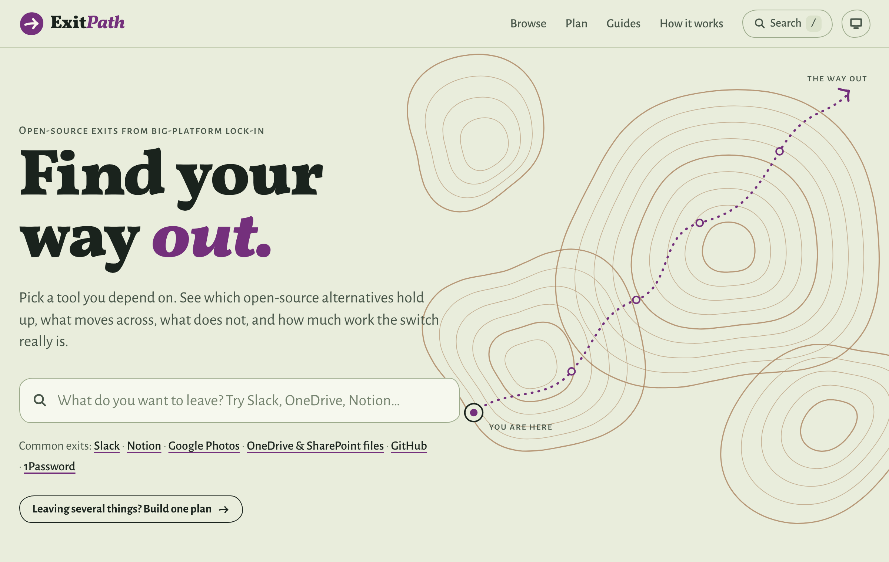
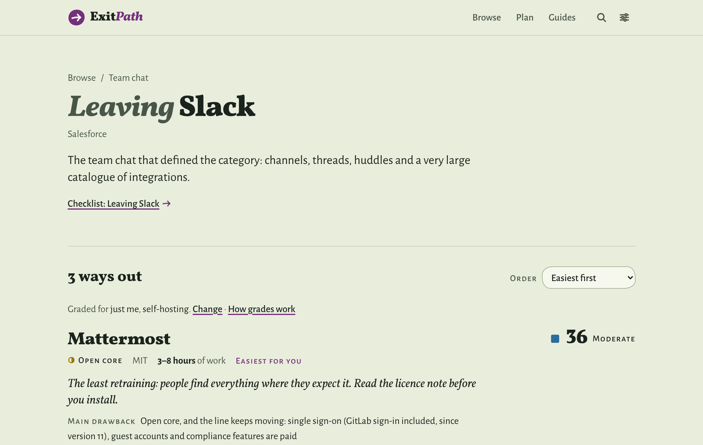

# ExitPath

Find your way out of big-platform lock-in.

ExitPath helps people and small teams find, compare and switch to open-source alternatives for the tools
they depend on: Microsoft 365, Google Workspace, Slack, Notion, GitHub and others. It is not another
software suite. It is a map of the projects that already exist, with the distances marked honestly: what
moves across, what does not, how hard the switch is, and the order to do it in.





## What it does

- **Searchable catalog.** 19 proprietary tools, 41 alternatives and 60 migration paths between them, from office suites and chat
  to the company login. Each
  alternative carries its real licence, who funds it, a maturity rating with a written rationale, and a list
  of weaknesses as well as strengths. Open-core and source-available projects are labelled as such.
- **Side-by-side comparison.** For any tool, compare its alternatives on features, licence, maturity,
  import difficulty, self-hosting difficulty and server requirements.
- **Migration difficulty score and effort estimate.** A 0–100 score and an hours-to-weeks estimate for
  every path, adjusted for how many people are moving and whether you self-host. The arithmetic is simple
  and shown in full on the "How it works" page.
- **Your plan.** Tick everything you use and get one combined exit plan: a path for each tool, the total
  hands-on work (counting a shared destination only once) and an order to do it in, easiest first. Tick
  moves off as you finish them, and see how many weeks the rest takes at the hours you can give.
- **Take it with you.** Copy a plan or a checklist as a Markdown task list for an issue tracker or a wiki,
  print either, or share a plan as a link. The link carries the plan in its address; nothing is uploaded.
- **Guided checklists.** Step-by-step plans for leaving Microsoft 365, Google Workspace, Slack and Notion,
  with progress and notes saved as you go, and a print layout for paper.
- **Options that change the answers.** Say who is moving, who runs the servers, how many hours a week you
  have and whether only fully open-source projects will do, and every grade, estimate and suggestion
  follows. Paths can be ordered by ease, fit or maturity. Colours and text size are there too.
- **Search from anywhere.** Press `/` or Ctrl+K on any page; it forgives a typo.
- **Links that matter.** Official docs, Docker Compose files, installers and one-click deploys for
  self-hosting, plus managed hosting options where they exist.

## Local-first

The whole catalog is bundled with the app. After the page loads it makes no network requests: no
analytics, no accounts, no web fonts, no API. Your options, plan and checklist progress live in your
browser's local storage and can be exported to a JSON file, imported on another device, or erased, all
from the options dialog.

On Vercel that promise is enforced rather than merely kept: [`vercel.json`](vercel.json) sends a content
security policy with `connect-src 'none'`, fonts from its own origin only, and no inline scripts or styles, so the page could not phone home
even if a dependency tried to. If you host it elsewhere, send the same headers.

## Run it

Requires Node.js 22.18 or newer.

```sh
npm install
npm run dev        # http://localhost:5173
```

| Command               | What it does                                           |
| --------------------- | ------------------------------------------------------ |
| `npm run dev`         | Start the development server                           |
| `npm run build`       | Type-check and build the static site into `dist/`      |
| `npm run preview`     | Serve the built site locally                           |
| `npm run validate`    | Check every catalog file against the schema            |
| `npm test`            | Run the test suite                                     |
| `npm run lint`        | Lint the source                                        |
| `npm run format`      | Format code and catalog files                          |
| `npm run check`       | Validate, lint, test and build: what CI runs           |
| `npm run check-links` | Fetch every link in the catalog and list the dead ones |

### Hosting it yourself

`npm run build` produces a fully static site in `dist/`. It uses relative asset paths and hash-based
routing, so it works from any path on any static host with no rewrite rules: copy the folder to a web
server, GitHub Pages or Codeberg Pages, or open it inside a desktop shell.

Link previews (the card shown when the site is shared) need absolute URLs. Set `SITE_URL` when building,
for example `SITE_URL=https://exit.example.org npm run build`; on Vercel the production domain is picked
up automatically. Without either, those tags are left out and everything else works.

Every catalog page ends with "Edit this entry" and "Report a problem" links. If you fork the project,
point them at your repository in [`src/lib/site.ts`](src/lib/site.ts).

## The catalog

Everything the app knows lives in [`catalog/`](catalog) as plain JSON, one file per entry:

```
catalog/
  categories.json     feature lists used for comparison
  tools/              proprietary tools, how to export from them, and the paths out
  alternatives/       open-source projects: licence, maturity, hosting, strengths, weaknesses
  suites/             bundles such as Microsoft 365, mapped to their component tools
  guides/             migration checklists
```

The shape of each file is defined once, in [`src/catalog/schema.ts`](src/catalog/schema.ts). The app's
types are inferred from it, `npm run validate` checks every file against it, and the validator also
enforces what a schema cannot: that ids match file names, references resolve, and every alternative has a
value for every feature in its category.

To fix a rating or add an entry, see [CONTRIBUTING.md](CONTRIBUTING.md) and
[catalog/README.md](catalog/README.md).

## How scores work

Every path gets a difficulty score from 0 to 100, built from six ratings on a 1–5 scale:

| Factor           | Weight | Comes from                                                  |
| ---------------- | ------ | ----------------------------------------------------------- |
| Getting data out | 15%    | The tool's export difficulty                                |
| Getting data in  | 20%    | The path's import difficulty                                |
| Running it       | 25%    | Self-hosting difficulty, or 1 if managed or nothing to host |
| Feature gap      | 15%    | Six minus the path's fit rating                             |
| Lock-in          | 15%    | The tool's lock-in rating: other people, formats, habits    |
| People to move   | 10%    | Your answer to "Who is moving?"                             |

The score is 60% the weighted average of those factors and 40% the single hardest of the first five,
because a migration is as hard as its hardest part: files that open anywhere do not help much while
everyone you work with still sends the old format. Effort is the path's per-person hours scaled by team
size, plus server setup time. The whole model is one short function in
[`src/lib/scoring.ts`](src/lib/scoring.ts), and it is meant to be argued with.

A low score means the move is easy, not that the destination is better. Each path also shows its fit, a
verdict, its main drawback, and the grade both self-hosted and hosted where a provider exists.

Ratings are opinions, not measurements. The first version of the catalog was compiled with an AI assistant
from each project's public documentation. Not every entry has been checked by someone who runs the
software, and not every outside link has been tested (`npm run check-links` does that). Every entry records
the month it was last reviewed, and corrections from people with first-hand experience are the most useful
contribution. Projects change licences, pricing and features, sometimes abruptly: check the project's own
documentation before committing a team to anything.

## Project layout

```
catalog/            the data (JSON)
scripts/            catalog validation CLI
src/
  catalog/          schema, validator and loader
  lib/              scoring, search, plans, sharing, local storage
  components/       shared UI
  pages/            one file per route
```

Built with React, TypeScript, Vite and Tailwind CSS. Runtime dependencies are React and React Router;
nothing else ships to the browser.

## The look

ExitPath reads like a pocket trail guide rather than a dashboard: map paper, one colour for routes,
difficulty graded the way trails are, and little else. There are no cards or panels; structure comes from
type, white space and hairlines, and detail stays folded away until you ask for it.

- **Grades have shapes.** Easy is a green circle, moderate a blue square, demanding a gold triangle, hard
  a red diamond and very hard a black double diamond. The shape and the word carry the grade, so nothing
  depends on telling colours apart. The four hues were checked for contrast and colour-blind separation
  on every background, in both themes.
- **Ratings are legends.** Every 1–5 rating is five dots and a word, with the word in ink. More filled
  dots is always better news, whichever way the underlying scale runs.
- **Lists are indexes.** A name, a row of dots, and what you will find there, as in the back of a
  guidebook.
- **Checklists are trails.** Steps are waypoints on a dotted line; progress is the stretch already walked.
- **One drawing.** The contour lines on the home page are generated from a seed in
  [`src/lib/contours.ts`](src/lib/contours.ts), so they are the same on every visit.
- **Typefaces are self-hosted.** Vollkorn for headings, Alegreya Sans for text and its small caps for
  labels, all under the SIL Open Font License and bundled from npm at build time. No font service is
  contacted.

Colours are CSS variables in [`src/index.css`](src/index.css) with light, dark and print values.

## Not built yet

Ideas that fit, roughly in the order they seem useful:

- Export and import helper scripts for the common paths (Takeout to Immich, OneDrive to Nextcloud, IMAP to IMAP)
- Community notes on what actually worked, moderated through pull requests
- Offline use after the first visit, and a desktop build that can check which services you already run
- Translations, and JSON Schema files for editor autocompletion in the catalog

## Licence

[MIT](LICENSE), code and catalog alike.
